# 纽约州立大学布法罗分校（UB)CS经——01大一上学期基础课（MTH141，科学课与CSE115精讲）

作者：**Ryuushonei**

[返回目录](../README.md) · [草稿分页存档](first-semester-draft.md)

来源：作者在小红书创作服务平台编辑的未发布草稿，迁移于 2026-10-11。

## 目录

- [第一学期课程](#第一学期课程)
- [科学课](#科学课)
- [MTH141（微积分1）](#mth141calc-ⅰ)
- [CSE115（计算机概论1）](#cse115introduction-to-computerscience-ⅰ)
- [Tracing quizzes](#tracing-quizzes)
- [后续计划](#后续计划)
- [项目仓库](#项目仓库)

## 第一学期课程

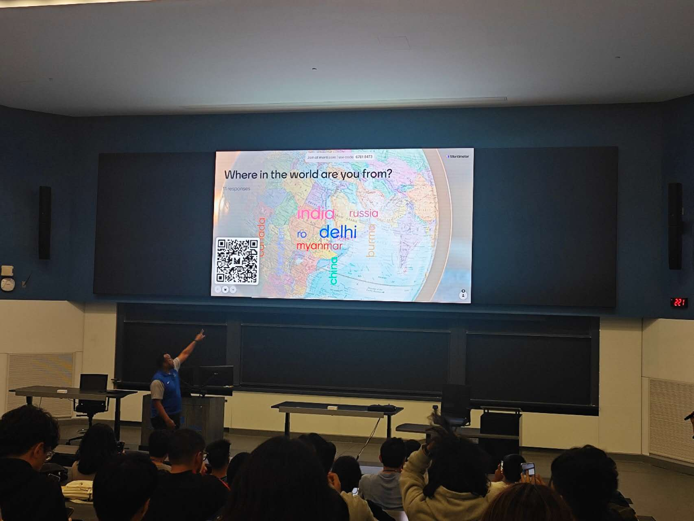

图为你将上大课的阶梯教室与你同学的主要来源

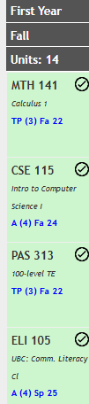

第一学期的课程包括CSE115（计算机概论1），MTH141（微积分1）和ELI105(学术英语）以及一门科学课（这里主包用在国内学的高阶统计换了实际上不用上这么难的），期中ELI105如果你是国际生需要先学ELI411（英语口语）和ELI100（英语写作）才能上。期中CSE115只教Python的基础语法和一些基础计算机知识，MTH141涵盖极限、微分和积分及其应用（主要是教你求导和一些函数的基本知识，你在国内公立高中基本都会学，好像洛必达都不用会），基础科学课也简单，我后面上的物理也就是初中水平物理。

## 科学课

这是科学课清单生物和地理涉及生词会多一点，可能有一定难度，物理生物化学全部有手就行没手也行（bonus给的很足还有curv，主包学物理期中满分80有70分加分，平时还有加分，后面期末没去都拿了A.

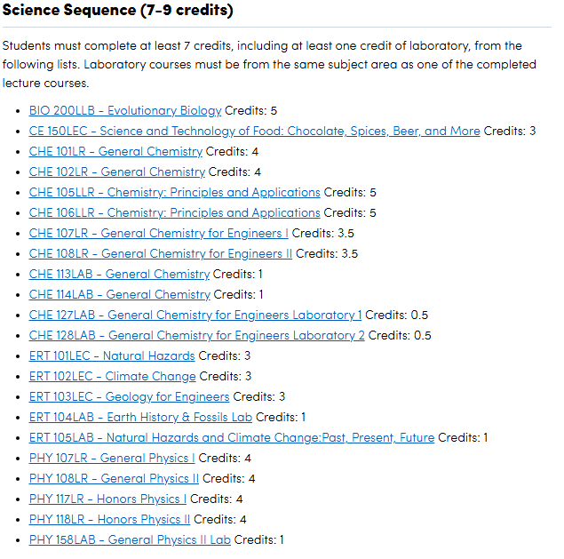

## MTH141(calc Ⅰ）

先来看MTH141（主包没在这上过，只辅导过富哥上这门课，大纲是找学妹要的）：

### 学习内容

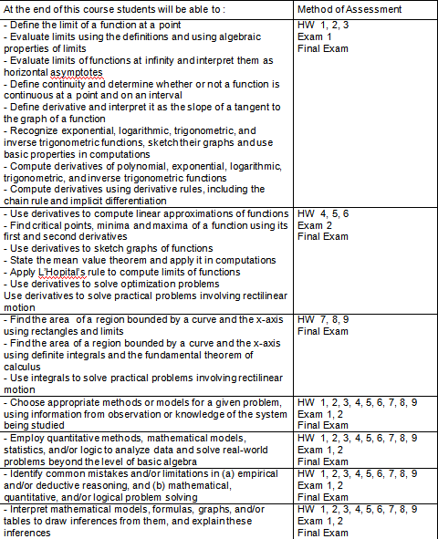

内容包括极限与连续（判断函数增减性，单调性，极值，拐点……），导数与求导方法（只有一阶导），导数的应用（知道导数代表斜率，斜率正就增负就减就行），定积分入门（甚至不包括积分求面积和公式推导）。连洛必达都不需要，那些增减性极值和拐点的题小学生都能做对，甚至不需要论证，英语菜也没问题（UB因为大部分助教水平一般必须写英文证明，纯数学符号论证TA可能看不到）。

### 成绩构成

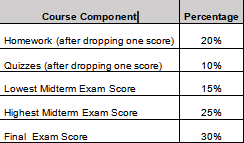

送分只有20%的作业，考试占比有70%小测占比10%，如果是高阶课我会说是很有挑战性的，但是鉴于其难度我会说是老师不希望有才智的学生浪费太多时间在考勤与作业上

### 成绩等级

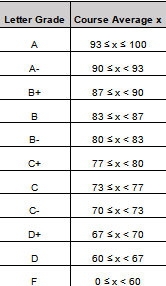

是一个93A的课，不过难度鉴定为右手就行没手也行，智力水平正常没有心理障碍稍微听听讲就能过。

## CSE115(Introduction to computerscience Ⅰ）

再来看CSE115(主包没存当年的课程大纲，这个大纲是26fall的）

### 授课教师

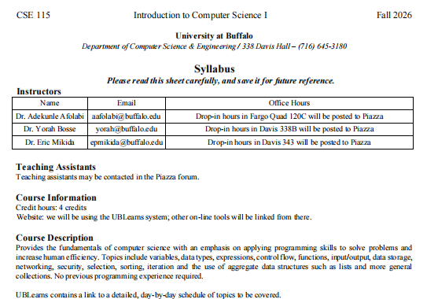

一共三个教授，Eric评分很高有4.6，Yorah评分3.1但是大部分差评是331的（这个课问题很大后面讲）和攻击她口音的，Adekunle Afolabi是新老师评分高达1.0（当然样本量很小）

#### Yorah


主包上的是Yorah的，但是课程很简单主包当年没怎么上过，评价将主要依据后面上的数据结构。Yorah老师是个很和善的老奶奶（阿姨？）很认真负责，ppt做的很好，如果你跟她聊天她会很开心，但是她不做research对于现在的几个cs原神没啥了解，你去跟她聊基础知识她能讲的很细，她是巴西人英语口音很重，班上当时有白皮小凳嘲笑这一点（UB的本地生源一般，很多学生很mean)，确实有点影响理解，主包被她查过一次作业开会的时候甚至听不懂她在问啥（主包英语也一般），后面我给她现场完整讲了一遍代码才过的，后面得知是我数据结构作业的库没设private被隔壁班三哥拾取了，但是她人好加上当时50人的数据结构去上课的包括我只有3个人，没有追责我（我没设好仓库相当于我也是有责任的）。她是巴西人在德国做过博士后，非常喜欢来找她的学生，主包当时拿病例去申请缓考她以为我找她写推荐信跟我说写完找她签字就行（主包和她英文都一般）。她会讲自己的经历并且对于很多人不来上课很失望，她讲的真的很好ppt也很好，我认为是本地学生不识货。

#### Eric


主包朋友上的是Eric的，他的评价是标准白男，给分比较严格但是态度不错，会现场演示编程，对电子产品感兴趣，主包只在别的课OH见过他没有说过话，给人的感觉是黄金时代留下的老白男对于现在学生质量下降感到遗憾却没有办法。

#### Adekunle Afolabi


Adekunle是一个中东老师，主包学弟说他的课水平很差口音很重，甚至现场演示编程都能演示错了，学生都用别的老师的ppt复习。

### 学习内容与考核方式

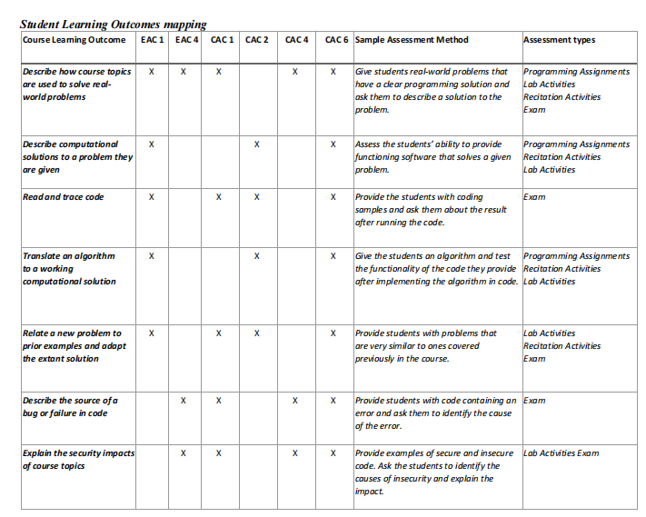

这是学习内容包括几大板块，计算机解决现实问题，读和跟踪代码，将算法翻译成方法，新问题联系旧案例，找简单的bug，找安全影响。真正考察的就是python编程和基础计算机知识，对计算思维（被认为是ai时代下最重要的要素）考察很少，考察方式包括课上问题（Tophat question相当于国内雨课堂其实是记考勤），作业，实验室作业（开卷但不能ai）,实验室考试（实验室敲代码）和tracing quize（UB特色，这玩意你在哈佛耶鲁mit都学不到）（但确实对于理解代码有很大的帮助）


### 成绩构成

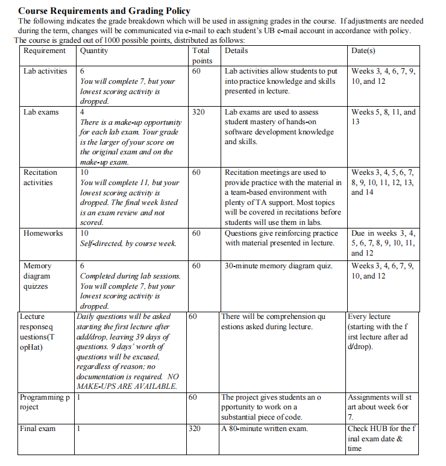

接下来是分数安排Lab activity(开卷实验室编程）占60分（6%）这部分纯送分，Lab exam(闭卷实验室编程）占320分（32%）每个考试能考两次取最高分有点难度但是考两次，Recitation activities（讨论课活动就是课上小组作业）占60分（6%）纯送分，Homework（作业）占60分（6%）这部分纯送分，Memory diagram quizzes（前文说的tracing quizze）占60分（6%）有一些难度，必须明白程序怎么运转有一定计算思维，Lecture response questions(考勤问题）占60分（6%）纯送分（其实可以不去课程线上答题这个课不计定位），Project（项目作业）占60分（6%）纯送分，final(期末考试)占320（32%）纯简单理论线下机考其实很简单。

### 成绩等级

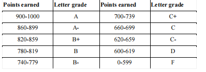

评分标准900分（90%）以上是A,600分（60%）以上及格，基本智力正常并且在疯玩期间偶尔学一下就能及格，拿A需要注意一下tracing quizzes和期末考试，期末考试主要包括简单的数据类型(判断啥是int啥是double啥是long，啥是string啥是bool)和编程语法（判断哪个语句是正确的哪个错误）还有一些计算机常识。

### Tracing quizzes

Tracing quizzes需要理解代码是怎么运转的，每一个地方存在何处这里仔细讲一下这张图里的（基本是CSE115里最难的了，看明白就可以过了）

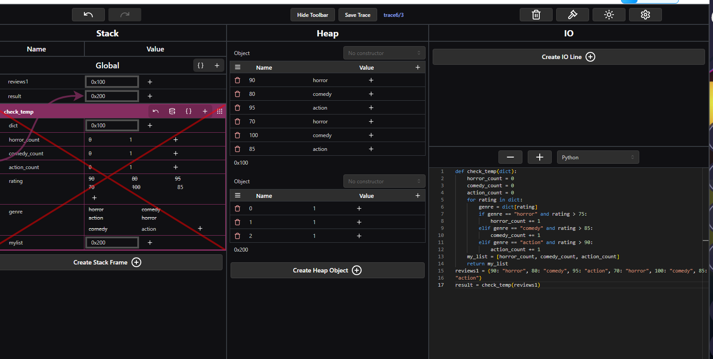

#### 先明确这个代码在干什么

这段代码就干一件事：把“歌手的分数”变成“对歌手的评价”，放进一个新dictionary里，图里的 Stack 和 Heap，是在展示这些变量和字典之间的关系。

我们来看这个程序具体在干什么，只有一个输入artist_dict，定义了一个dictionary- artist_ratings 存着这些分数：

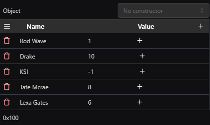

判断规则就是：低于 5 分给差评，5～7 分给中评，8 分及以上给好评。这行代码负责挨个取出歌手的名字：

```python
for artist in artist_dict.keys():
```

第一次循环时：

```python
artist                  # "Rod Wave"
artist_dict[artist]      # 1，也就是他的分数
```

因为 1 < 5，就往新字典里加一条：

```python
new_dict["Rod Wave is trash"] = "Please stop making music"
```

这里，左边的 "Rod Wave is trash" 是key（键），右边那句话是value（值）。 接下来继续处理其他歌手。

#### 左边 Stack 和中间 Heap 怎么看？

在这张教学图里，你可以这样理解：

- Stack：记录变量叫什么、指向哪个对象。
- Heap：展示字典对象本身，以及里面存了什么。

0x100 和 0x200 可以先当成两个字典的“编号”（这个课程不用纠结十六进制，你到后面CSE250再纠结）

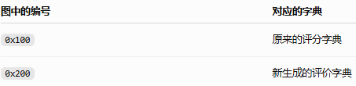

关键是：不同变量，可以指向同一个字典。

##### 第一步：把原字典传给函数

```python
rating_dict = trash_detector(artist_ratings)
```

调用函数时，外面的 artist_ratings 被传给里面的参数 artist_dict。因此：

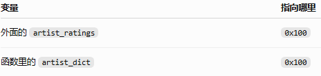

没有复制字典，只是同一个字典在函数里又有了一个名字。

所以函数里写：

```python
artist_dict["Drake"]
```

和外面写：

```python
artist_ratings["Drake"]
```

访问的是同一条数据，都是 10。

##### 第二步：创建一个新字典

函数里执行：

```python
new_dict = {}
```

这次才是真的新建了一个字典，图里用 0x200 表示。

之后每次循环，都把评价加进这个新字典。原来的评分字典没有被修改。

##### 第三步：把新字典交给外面

函数最后执行：

```python
return new_dict
```

外面的这一行就把结果接住：

```python
rating_dict = trash_detector(artist_ratings)
```

此时，rating_dict 指向的就是 0x200，也就是函数刚刚填好的那个新字典。 不会再额外复制一份。

#### 3. 左边函数上的红叉是什么意思？

红叉表示：这次函数调用结束了，它的局部变量不再保留在这个栈帧里。

函数里的这些名字退出了：

```text
artist_dict
new_dict
artist
```

但要分清楚：

变量名字消失，不等于它指向的字典也被删除。

虽然函数里的 new_dict 没了，外面的 rating_dict 还指向那个评价字典，所以字典继续存在。

你可以把字典想成一本本子：

函数里用 new_dict 这个名字叫它，返回后，外面用 rating_dict 这个名字继续叫它。函数结束了，本子已经交出去了。

所以最终图里保留下来的是：

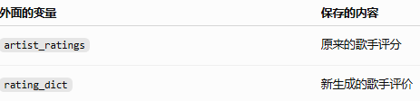

#### 4. 为什么右边 IO 是空的？

因为代码里没有 print()。要看结果，可以加：

```python
print(rating_dict)
```

这张图最关键的地方就是：函数结束后，局部变量 new_dict 消失了，但它创建的字典已经被外面的 rating_dict 接住，所以仍然存在。

能自己写出来上面的解析你就能基本理解代码了，就有了一定的计算思维，主包这里有之前的练习题有意者可以要一下。

## 后续计划

这就是本次攻略了，下一篇会讲大一下学期的CSE116（计算机基础2）和CSE191（离散结构）并且会介绍UB CS争议性最大的老师Thomas Hayes

## 项目仓库


本项目已有github仓库：https://github.com/cccp1917117/UB_CS_Navigate

---

[返回目录](../README.md) · [查看草稿分页存档](first-semester-draft.md)
