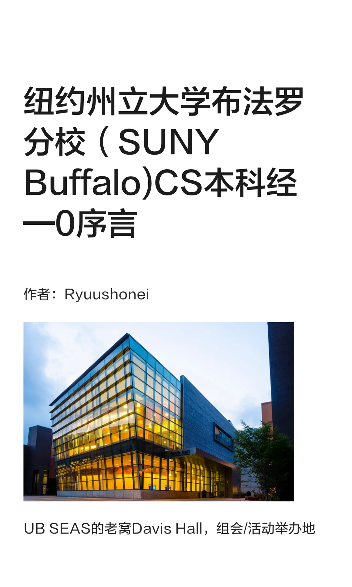
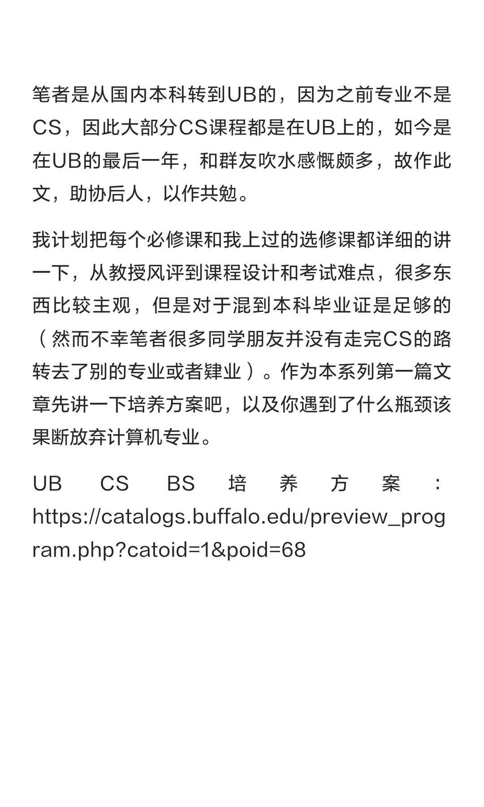
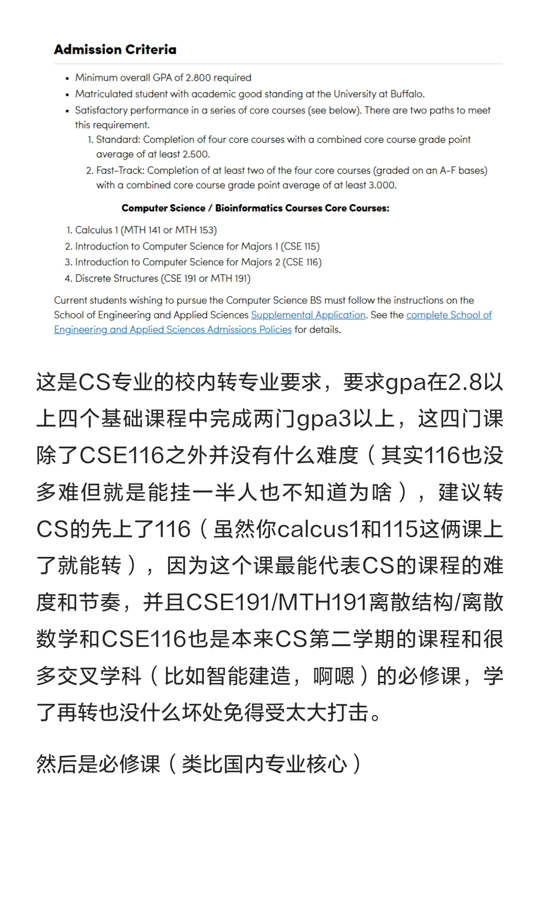
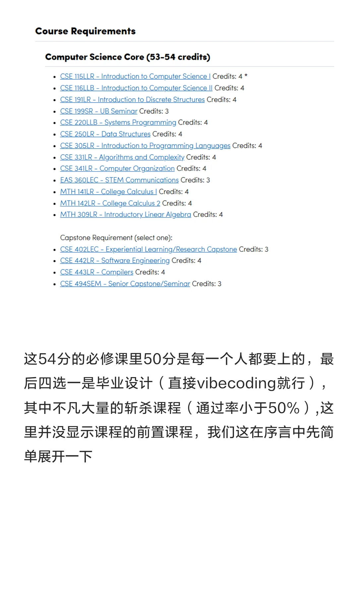
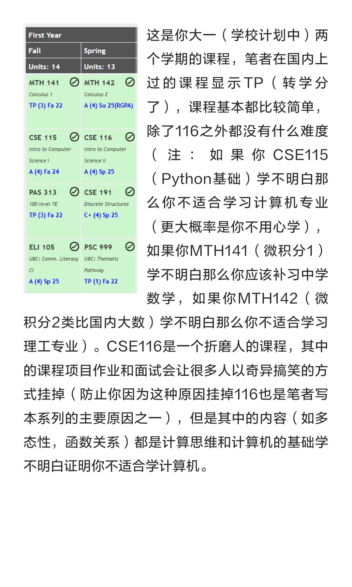
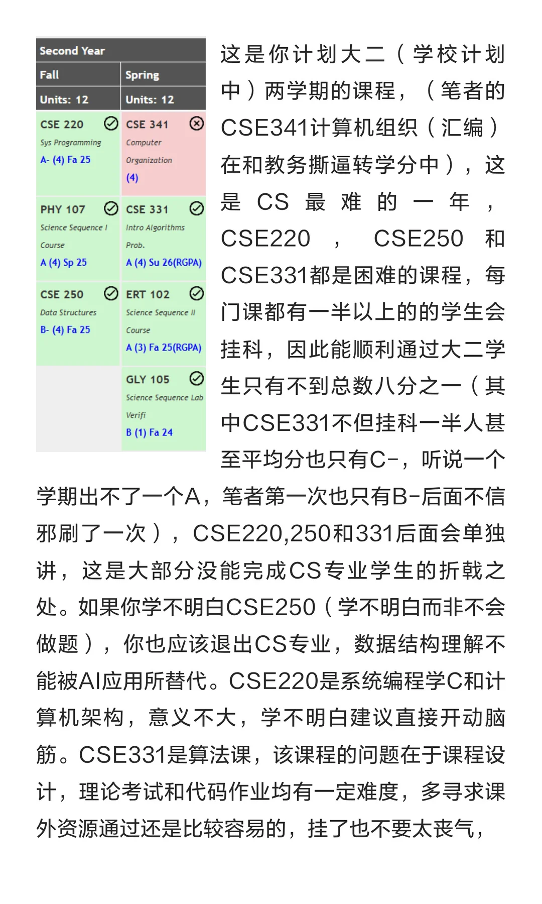
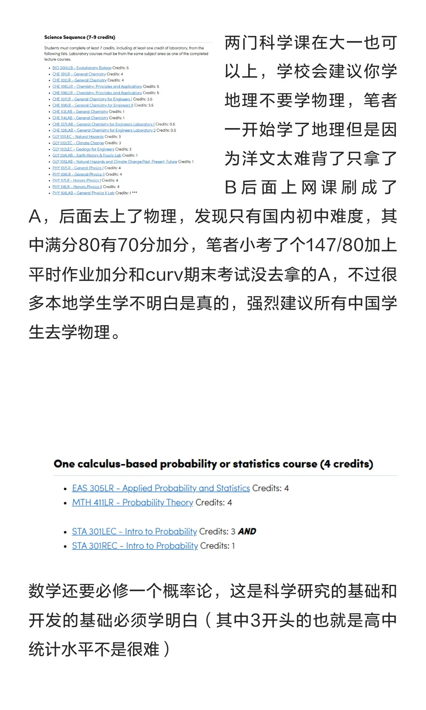
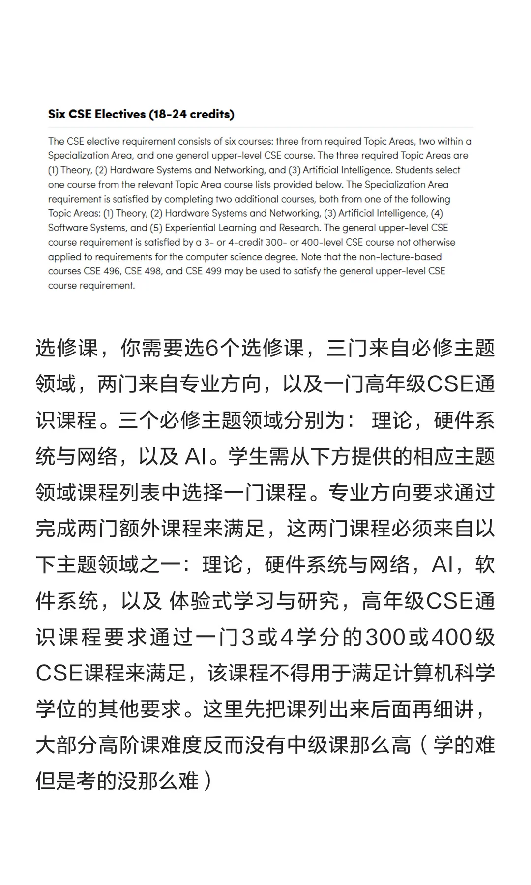
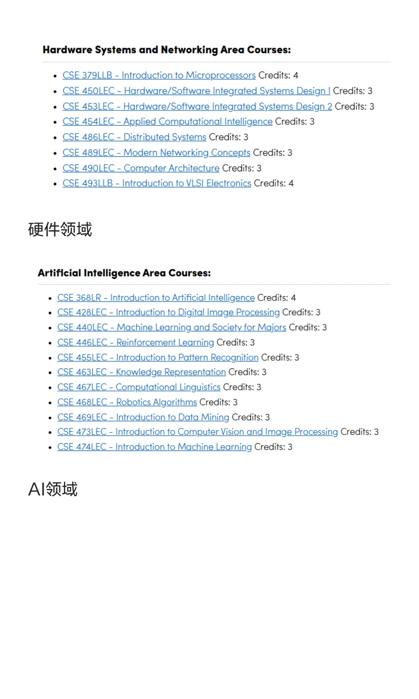
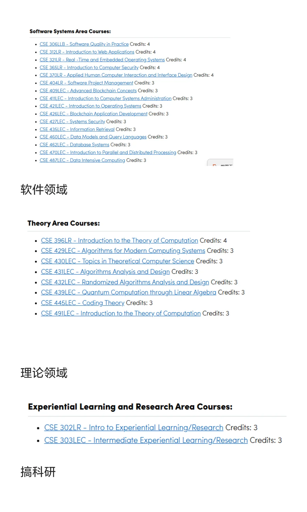

# 序言 · 原文图文存档

作者：**Ryuushonei**

来源：[纽约州立大学布法罗分校（UB）CS 经—序言 · 小红书](https://www.xiaohongshu.com/explore/6abfe903000000001802a9fb)

[阅读文字版](00-preface.md) · [返回目录](../README.md)

以下为原笔记的全部 10 张图片，按发布顺序保存。

## 第 1 页 · 封面

## 第 2 页 · 写作缘起

## 第 3 页 · 校内转专业

## 第 4 页 · 必修课与毕业设计

## 第 5 页 · 大一课程

## 第 6 页 · 大二课程

## 第 7 页 · 科学课与概率统计

## 第 8 页 · 选修课要求

## 第 9 页 · 硬件与 AI

## 第 10 页 · 软件、理论与科研

