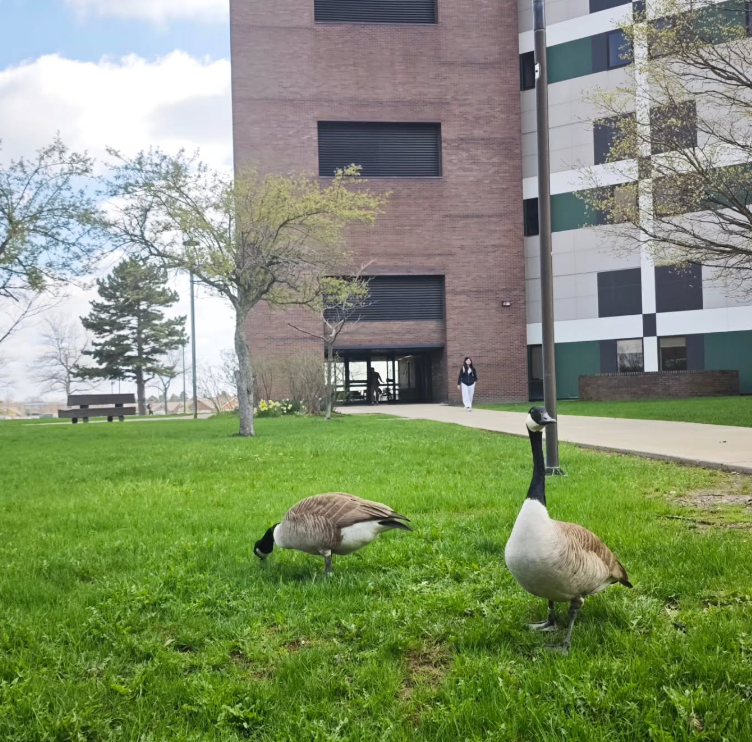
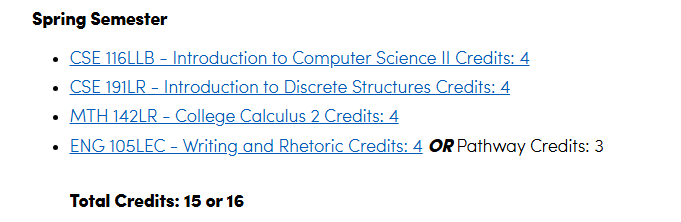
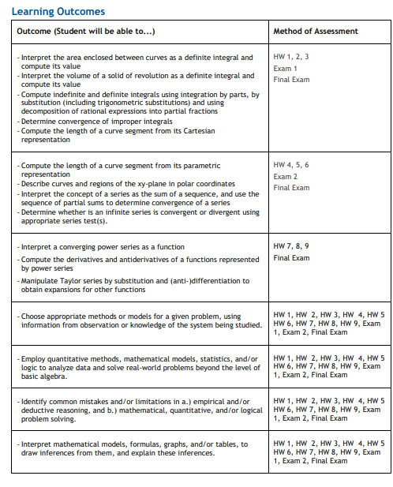
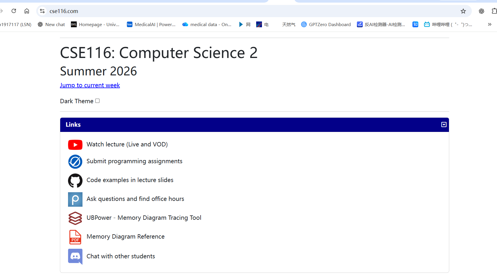
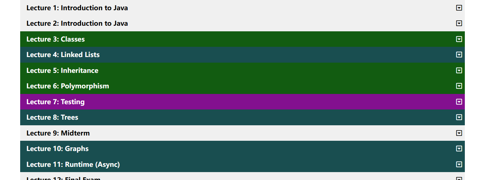
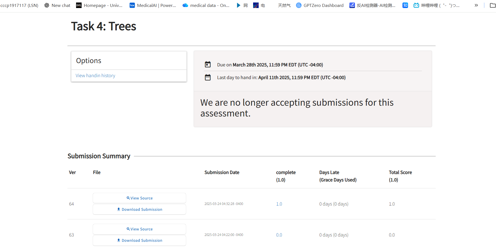
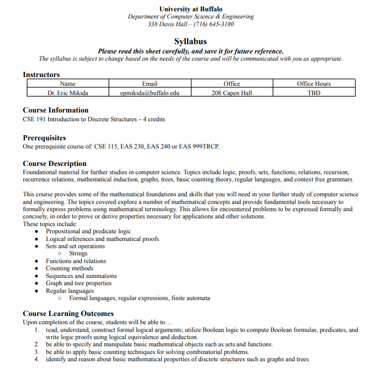
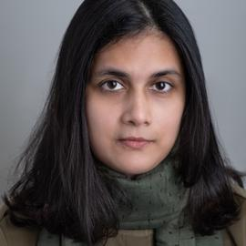
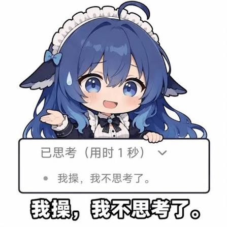

# 大一下学期基础课 · 小红书草稿分页存档

作者：**Ryuushonei**

原标题：纽约州立大学布法罗分校（SUNY-UB)CS经——02大一下学期（CSE116,CSE191，MTH142)

来源：作者在小红书创作服务平台编辑的未发布草稿，迁移于 2026-10-19。

[阅读文字版](02-second-semester.md) · [返回目录](../README.md)

以下按编辑器的 14 页顺序保存正文及全部 12 张配图；分页处的断句、拼写与原文表述保留。配图已保存到仓库，不依赖小红书临时图片链接。

## 第 1 页

纽约州立大学布法罗分校（SUNY-UB)CS经——02大一下学期（CSE116,CSE191，MTH142)

作者：Ryuushonei

## 第 2 页

校园里的大肥鹅，你的学长学姐，走路玩手机还有可能揍你

恭喜你学完了CSE115和MTH141来到了大一下学期，现在要接触一点计算科学的皮毛了，在之前你复习了一遍中学数学，学了一下python的基础语法和一些计算机小知识，现在是时候学一下真正的微积分（MTH142)和计算机常用知识了（CSE116)，还有离散解构（CSE191），这是一切算法的基础。从这学期开始很不幸一些数学思维不好或者不够勤奋的小伙伴要离开了计算机科学学科了，大约有一半的同学无法通过这学期，如果遇到无法战胜的困难请及时联系adviser，转专业止损。我们接下来来看具体课程

### MTH142(Calc II)

## 第 3 页

这门课主要讲 微积分Ⅱ 的六块内容：

1. 积分技巧：学习换元、分部积分等方法，计算比较复杂的积分。
2. 积分的应用：用积分计算曲线之间的面积、旋转体的体积和曲线长度。

## 第 4 页

3. 反常积分：当积分范围无限大，或者函数趋向无穷大时，判断积分有没有有限结果。
4. 参数方程与极坐标：学习用不同方式表示曲线和位置。
5. 无穷级数：研究无限多个数相加，最后是否趋向一个有限值。
6. 幂级数和泰勒展开：用多项式表示或近似复杂函数，并进行求导、积分。

基本都是算数没有证明，记明白公式咋用就行（甚至考试会后面把所有公式列出来），洋文不会也能考好一些，不过选对老师很重要，这个课有个Tara Hudson的白女老师比较事，每周都有课堂考试，判卷也严，扣过程分让主包感觉回到了高中备战高考的年代。评分也是90A的常规评分没啥难的，考试就是国内高数难度（算数难一些因为可以用计算器）。

### CSE116(计算机基础II)

## 第 5 页

这个课程有公开的课程大纲和作业要求在cse116.com，这个课程学习的东西除了多态性Polymorphism和继承Inheritance需要一点理解能力之外，其他的并没有理论上的难点。课程考察分为，面试，作业，Tracing，代码考试四个部分，这个课程有一种很独特的考试模式叫做“interview”在实验课上，TA会问你理论知识，你要解释给他们各个理论，然后给你打分，这里就很看造化了(有的TA会根据你的意思写答案，有的

## 第 6 页

TA会直接扣定义（当然大部分TA都挺好的）），Tracing和115一样，不过要复杂一些，涉及继承和多态性的有一点麻烦。Coding exam就是敲代码（这里甚至是你带着自己的计算机去敲，很多辅助工具可以用，还可以自己写辅助函数很简单（相对于下学期））

作业其实是相对困难的，这个课程作业是要写一个完整的游戏，期中Tree一章节最难，你需要用Tree实现AI的运动逻辑，这里面老师的要求写的并不清楚，会出现你写的字面实现了但是就是过不了测试的情况，主包写了64次才猜出来老师的要求是啥，这里你用ai也过不了只能不断的改，猜老师怎么写的测试，主包写了一晚上（当然也有人8次就过了）。

## 第 7 页

这个课程的老师有Paul和Jessy

都是不错的老师，Paul评分是3.7他是UB  CSE最chill的老师，很友好（主包小组作业遇到神奇宝贝了他还劝我水一点没关系别把自己累死），是授课教授，还教3d游戏开发（CSE420)，这是一个很好的课程，你可以做出来一个东西来忽悠外行，当老资历。这老师比较喜欢潮酷的东西，主包写了

## 第 8 页

个神经网络计算裙摆以实现椅子能坐，他很喜欢。

Jessy评分3.2（大部分是好评有很多人评价116太难了但是没人说教的不好），现在在做安全相关的研究，也是不错的老师，讲课很好，喜欢努力的学生，还教CSE312(web开发)。课程网站做的很

## 第 9 页

好，架构很直观。

CSE191(离散结构）

这个课程讲的是离散结构，重点在于数学论证以及基础概念，在名为计算机科学的开放世界中，认识不同的概念，论证方法，并且逐渐了解算法的真相，内容主要包括。

## 第 10 页

- 逻辑与证明：判断命题真假，学习逻辑推理、数学归纳法，证明一个结论为什么成立。
- 集合、函数和关系：研究元素如何分组、对应，以及它们之间有什么关系。
- 排列组合与计数：计算一个问题有多少种可能，例如密码组合、人员排列。
- 数列、求和、递归与递推：研究按规则生成的数列，以及怎样从前面的结果得到后面的结果。
- 图和树：研究节点与连线组成的结构，例如网络连接、路径和树形结构。
- 形式语言：学习正则表达式、有限自动机和文法，理解怎样描述和识别字符串的规则。

## 第 11 页

这个课程主要是Nasrin Akhter这个孟加拉老师在教，Nasrin Akhter是很杰出的老师，在做计算生物学研究，主要方向也是ai和算法，并且不排斥中国人进组，主包有同学就在她组里干过，老师很nice会亲自回答你在piazza上提的问题，并且态度很友好，这个老师虽然是孟加拉人但是好像是印度教徒，主包有一次去她办公室看她在焚香，很多人会用lovely形容这个老师。

## 第 12 页

Thomas Hayes也是ub的算法课主要老师鉴于CSE331要到至少两期之后才写，而他也教过191，就先把他写出来了。他的风评褒贬不一，很多学生课上经常跟不上他的思路（主要ub生源不行），最终退课或者不来lecture（主包上他331有一次阶梯教室百人大课变1对1了）导致评分比较低，但是他实际上是非常好的老师，主要在研究算法，马尔可夫链，算法的物理学等等，他的重心在research上但是也很用心的在教课，如果你去问他问题，他会很热心和高兴的像你讲题（但是很多

## 第 13 页

学生表示听不懂），主包觉得这个老师不错，虽然他的研究和授课都比较难吧，但他真的很努力在尝试教明白你。他现在不教191了（但不排除以后不教）但是他主要教331和429两节算法课，331会让很多学生犯难（当然主要是ub生源不行），但他确实是小众且独特的好老师，适合喜欢挑战自己进一步提高的同学选择。他的课挂科比较多，但是他会用curv捞人。

## 第 14 页

本项目github仓库已部署

https://github.com/cccp1917117/UB_CS_Navigate
